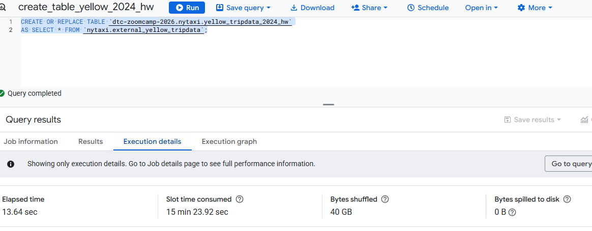
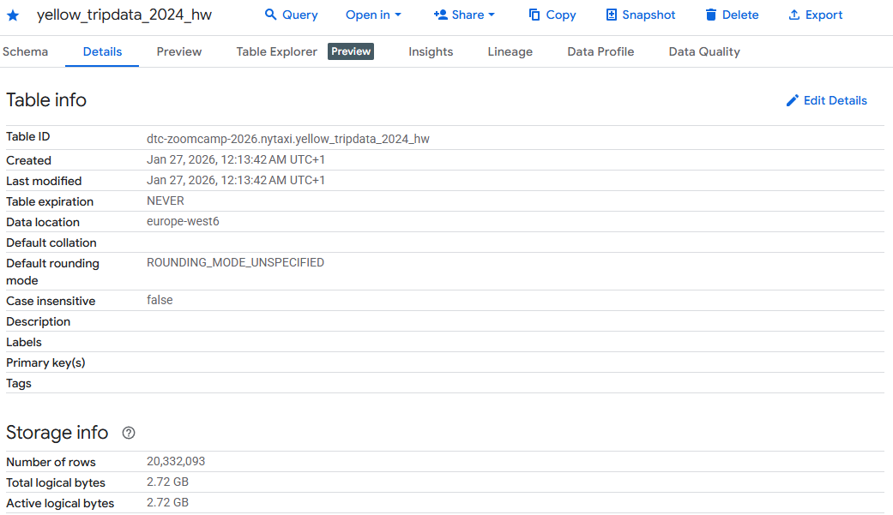
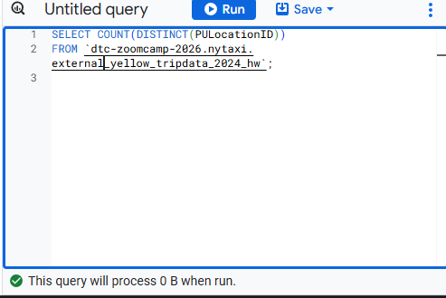
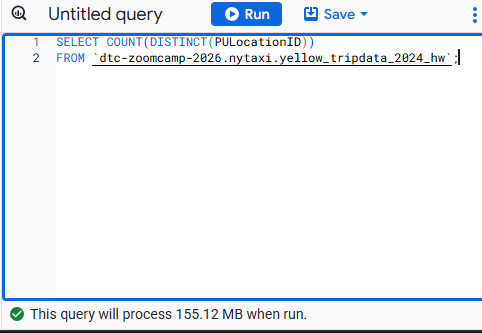
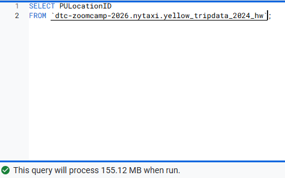
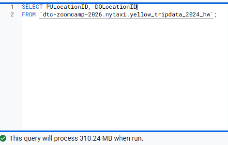
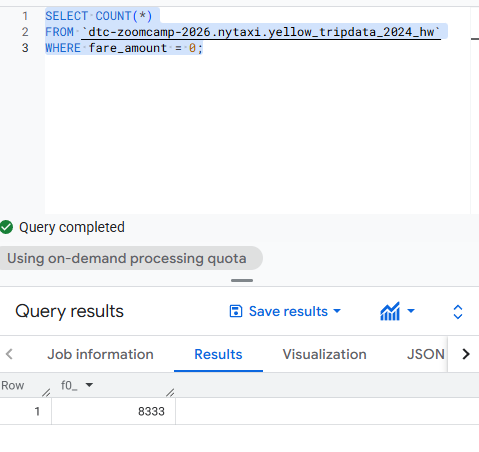
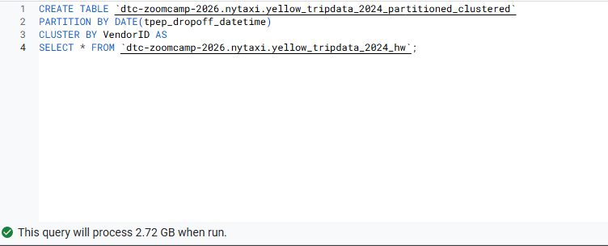
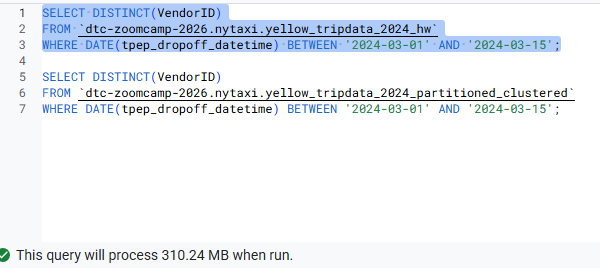
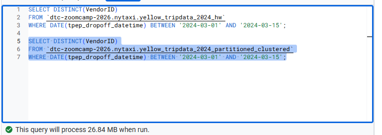

## Module 3 Homework

<b>BIG QUERY SETUP:</b></br>
Created an external table using the Yellow Taxi Trip Records. </br>
Created a (regular/materialized) table in BQ using the Yellow Taxi Trip Records (do not partition or cluster this table). </br>
</p>

## Question 1:
What is count of records for the 2024 Yellow Taxi Data?</br> 

```sql 
-- question 1
-- create external table
CREATE OR REPLACE EXTERNAL TABLE `dtc-zoomcamp-2026.nytaxi.external_yellow_tripdata_2024_hw`
OPTIONS (
  format='PARQUET',
  uris=[
    'gs://dtc-data-lake-nyc-buket-hw/yellow/yellow_tripdata_2024-*.parquet'    
  ]
)

-- create materialized table
CREATE OR REPLACE TABLE `dtc-zoomcamp-2026.nytaxi.yellow_tripdata_2024_hw`
AS SELECT * FROM `dtc-zoomcamp-2026.nytaxi.external_yellow_tripdata_2024_hw`;

-- count lines
SELECT COUNT(*) FROM `dtc-zoomcamp-2026.nytaxi.yellow_tripdata_2024_hw`;
```




- 65,623
- 840,402
- X 20,332,093
- 85,431,289


## Question 2:
Write a query to count the distinct number of PULocationIDs for the entire dataset on both the tables.</br> 
What is the **estimated amount** of data that will be read when this query is executed on the External Table and the Table?</br> 
```sql 
-- question 2
-- external table
SELECT COUNT(DISTINCT(PULocationID))
FROM `dtc-zoomcamp-2026.nytaxi.external_yellow_tripdata_2024_hw`;

-- materialized table
SELECT COUNT(DISTINCT(PULocationID))
FROM `dtc-zoomcamp-2026.nytaxi.yellow_tripdata_2024_hw`;
```



- 18.82 MB for the External Table and 47.60 MB for the Materialized Table
- X 0 MB for the External Table and 155.12 MB for the Materialized Table
- 2.14 GB for the External Table and 0MB for the Materialized Table
- 0 MB for the External Table and 0MB for the Materialized Table

The estimated amount of data read for the external table is 0 Mb because the data have not been loaded in BQ yet (still in GCS) so impossible for BQ to estimate it.

## Question 3:
Write a query to retrieve the PULocationID from the table (not the external table) in BigQuery. Now write a query to retrieve the PULocationID and DOLocationID on the same table.</br> 
Why are the estimated number of Bytes different?</br> 
```sql 
-- question 3
SELECT PULocationID
FROM `dtc-zoomcamp-2026.nytaxi.yellow_tripdata_2024_hw`;

SELECT PULocationID, DOLocationID
FROM `dtc-zoomcamp-2026.nytaxi.yellow_tripdata_2024_hw`;
```


- X BigQuery is a columnar database, and it only scans the specific columns requested in the query. Querying two columns (PULocationID, DOLocationID) requires 
reading more data than querying one column (PULocationID), leading to a higher estimated number of bytes processed.
- BigQuery duplicates data across multiple storage partitions, so selecting two columns instead of one requires scanning the table twice, 
doubling the estimated bytes processed.
- BigQuery automatically caches the first queried column, so adding a second column increases processing time but does not affect the estimated bytes scanned.
- When selecting multiple columns, BigQuery performs an implicit join operation between them, increasing the estimated bytes processed

## Question 4:
How many records have a fare_amount of 0?</br> 
```sql 
-- question 4 
SELECT COUNT(*)
FROM `dtc-zoomcamp-2026.nytaxi.yellow_tripdata_2024_hw`
WHERE fare_amount = 0;
```

- 128,210
- 546,578
- 20,188,016
- X 8,333

## Question 5:
What is the best strategy to make an optimized table in Big Query if your query will always filter based on tpep_dropoff_datetime and order the results by VendorID (Create a new table with this strategy)</br> 
```sql 
-- question 5
CREATE OR REPLACE TABLE `dtc-zoomcamp-2026.nytaxi.yellow_tripdata_2024_partitioned_clustered`
PARTITION BY DATE(tpep_dropoff_datetime)
CLUSTER BY VendorID AS 
SELECT * FROM `dtc-zoomcamp-2026.nytaxi.yellow_tripdata_2024_hw`;
```

- X Partition by tpep_dropoff_datetime and Cluster on VendorID
- Cluster on by tpep_dropoff_datetime and Cluster on VendorID
- Cluster on tpep_dropoff_datetime Partition by VendorID
- Partition by tpep_dropoff_datetime and Partition by VendorID


## Question 6:
Write a query to retrieve the distinct VendorIDs between tpep_dropoff_datetime
2024-03-01 and 2024-03-15 (inclusive)</br>

Use the materialized table you created earlier in your from clause and note the estimated bytes. Now change the table in the from clause to the partitioned table you created for question 5 and note the estimated bytes processed. What are these values? </br>

Choose the answer which most closely matches.</br> 
```sql 
-- question 6
SELECT DISTINCT(VendorID)
FROM `dtc-zoomcamp-2026.nytaxi.yellow_tripdata_2024_hw`
WHERE DATE(tpep_dropoff_datetime) BETWEEN '2024-03-01' AND '2024-03-15';

SELECT DISTINCT(VendorID)
FROM `dtc-zoomcamp-2026.nytaxi.yellow_tripdata_2024_partitioned_clustered`
WHERE DATE(tpep_dropoff_datetime) BETWEEN '2024-03-01' AND '2024-03-15';
```


- 12.47 MB for non-partitioned table and 326.42 MB for the partitioned table
- X 310.24 MB for non-partitioned table and 26.84 MB for the partitioned table
- 5.87 MB for non-partitioned table and 0 MB for the partitioned table
- 310.31 MB for non-partitioned table and 285.64 MB for the partitioned table


## Question 7: 
Where is the data stored in the External Table you created?

- Big Query
- Container Registry
- X GCP Bucket
- Big Table

## Question 8:
It is best practice in Big Query to always cluster your data:
- True
- X False

Clustering or partitioning is interesting when:
- your queries filter always on a peculiar column (or up to 4 peculiar columns)

Let's do a decision tree on: 
- clustering
- partitioning 
- do nothing.

Will we most often filter or sort our data based on a peculiar column (or up to 4 columns)?
- No: no partitioning nor clustering
- Yes:
  - will the partitions size of the first column be at least 1 Gb ?
    - Yes:
      - will the cardinality of the column be < 4 000 values (BQ limit)?
        - Yes: partition 1st column, cluster your other column(s) (up to 4) if needed
        - No: cluster your column(s) (up to 4)
    - No: cluster your column(s) (up to 4)


## (Bonus: Not worth points) Question 9:
No Points: Write a `SELECT count(*)` query FROM the materialized table you created. How many bytes does it estimate will be read? Why?
```sql 
-- question 9 
SELECT count(*)
FROM dtc-zoomcamp-2026.nytaxi.yellow_tripdata_2024_hw;
```
It reads no bytes at all because this information is already known since the table creation. </br>
It's just the number of rows in the table and it's stored in the metadata of the table.

